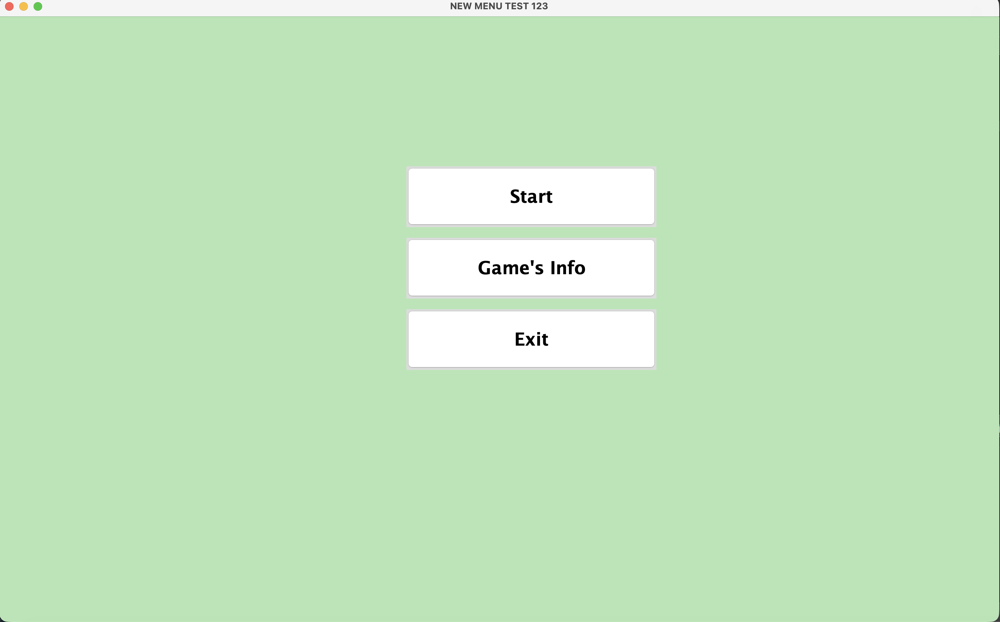
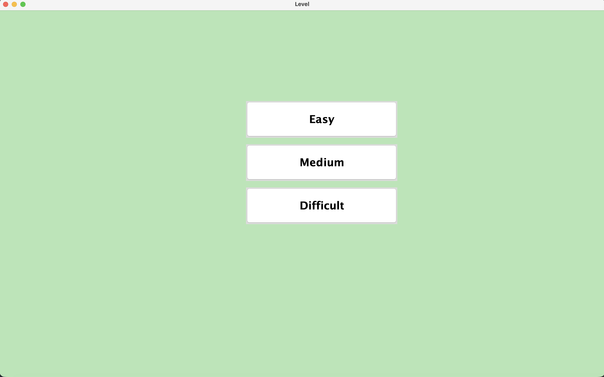
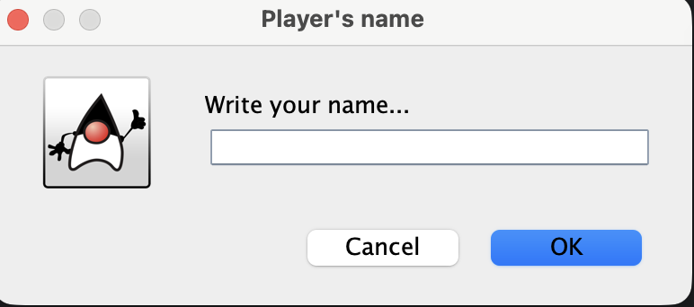
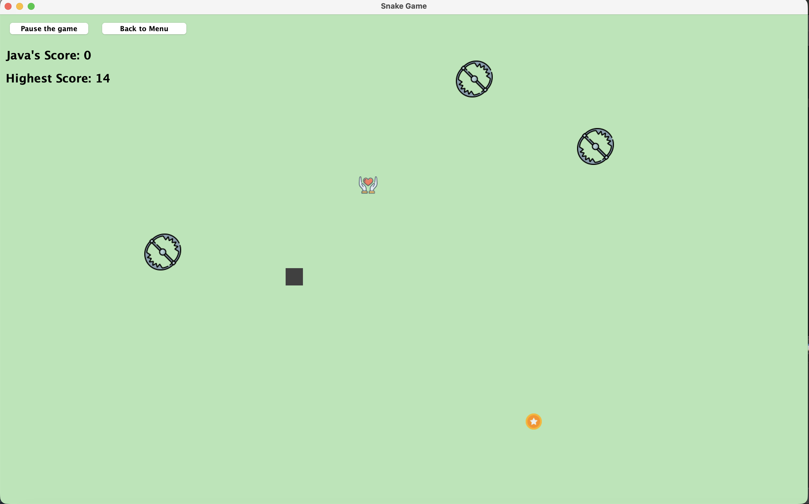
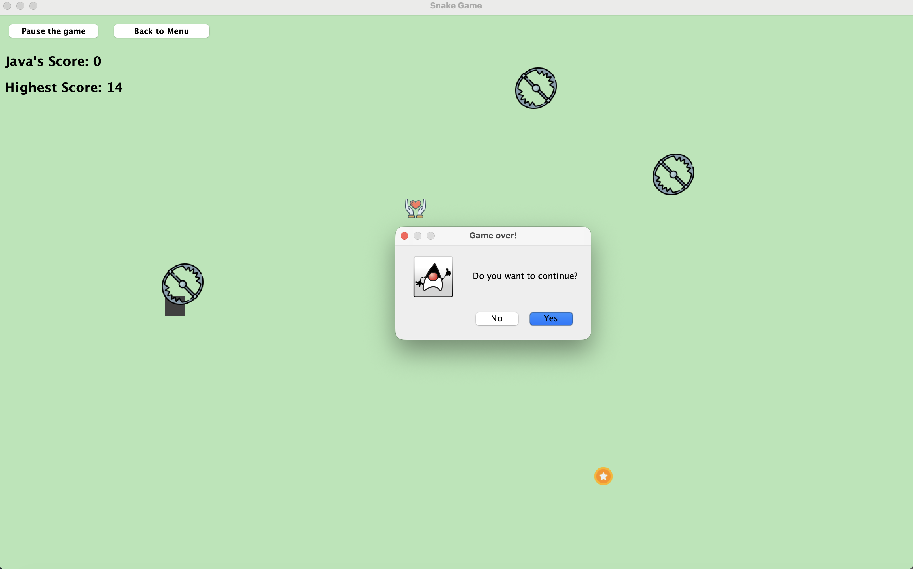

# Venom Run

A Java-based arcade game developed using Java Swing. Venom Run challenges players to collect rewards, avoid obstacles, and achieve the highest possible score across three difficulty levels.

The project demonstrates object-oriented programming, event handling, graphical user interface development, collision detection, and local file-based data persistence.

## Features

- **Three difficulty levels:** Easy, Medium, and Difficult, with different game speeds and obstacle behavior.
- **Interactive gameplay:** Control the player using the keyboard to collect rewards and avoid traps.
- **Dynamic obstacles:** Moving traps increase the challenge at higher difficulty levels.
- **Scoring system:** Earn points by collecting rewards and bonus hearts.
- **Persistent high scores:** Separate high scores for each difficulty level, saved locally between sessions.
- **Pause and resume:** Pause gameplay and continue whenever you're ready.
- **Main menu navigation:** Return to the main menu directly from the game screen.
- **Sound effects and background music:** Audio feedback during gameplay.


## Screenshots

### Main Menu


### Difficulty Selection


### Player Name


### Gameplay


### Pause and Resume



### Main Menu

### Difficulty Selection

### Gameplay

## Technologies Used

- **Java** — Core game logic and object-oriented programming
- **Java Swing** — Graphical user interface and event handling
- **Java AWT** — Graphics rendering and collision detection
- **Java Sound API** — Sound effects and background music
- **Java NIO** — Local file-based high-score storage
- **Eclipse IDE** — Development environment

## Game Controls

| Control | Action |
|---|---|
| ↑ | Move up |
| ↓ | Move down |
| ← | Move left |
| → | Move right |
| Pause the Game | Pause gameplay |
| Resume | Continue gameplay |
| Back to Menu | Return to the main menu |

## Getting Started

### Prerequisites

- Java Development Kit (JDK) compatible with the project's Java version
- Eclipse IDE or another Java development environment

### Installation

1. Clone the repository:

   ```bash
   git clone https://github.com/Abid-04/Venom-run.git
   ```

2. Open Eclipse IDE.
3. Select **File → Import → General → Existing Projects into Workspace**.
4. Select the cloned project directory.
5. Verify that the project uses a compatible JDK.
6. Run the game's main Java class.

The game does not require MySQL or an external database server.

## High Score Storage

Venom Run saves high scores locally in the user's home directory.

Each difficulty has its own file:

```text
.venom-run/
├── easy.txt
├── medium.txt
└── difficult.txt
```

Only the highest score achieved for each difficulty is retained. Records remain available after closing and restarting the game.

## Project Structure

The project includes the following Java classes:

| Class | Responsibility |
|---|---|
| `Menu.java` | Main menu interface |
| `Level_.java` | Difficulty selection |
| `Frame_.java` | Game window setup |
| `Panel_.java` | Gameplay, rendering, collision detection, and controls |
| `Player.java` | Player movement and rendering |
| `Database.java` | Local high-score persistence |

## Future Improvements

Potential enhancements include:

- Improved responsive window layouts
- Additional obstacles and gameplay mechanics
- Enhanced animations and visual effects
- Packaging the game as a standalone application

## Author

Developed by **Abid**.

GitHub: [Abid-04](https://github.com/Abid-04)

## License

No license has been specified for this project.
